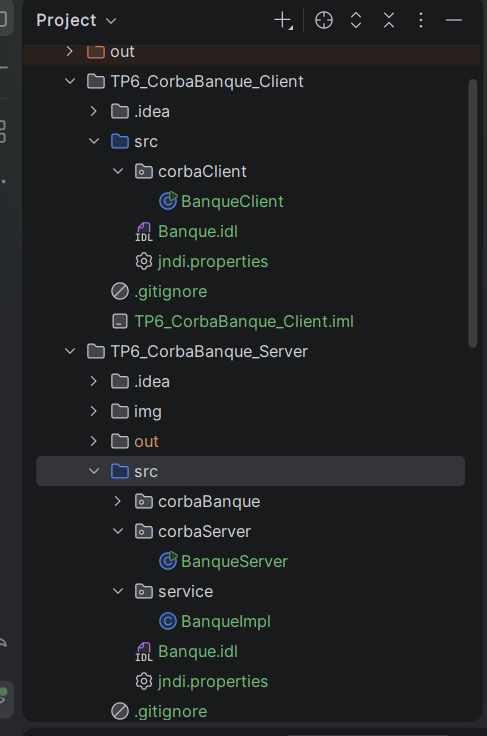
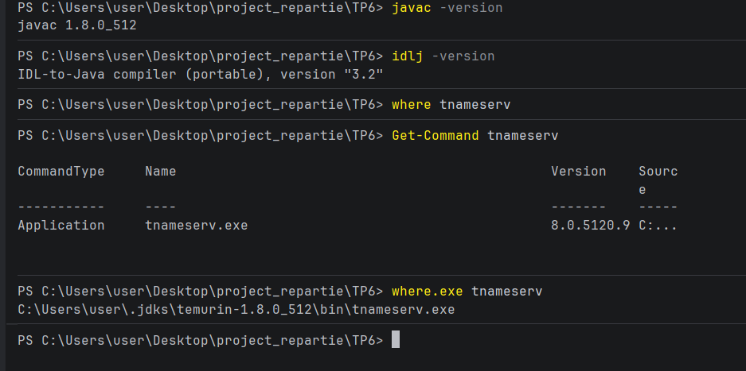
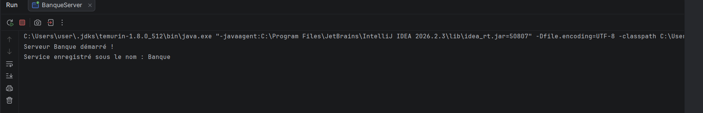
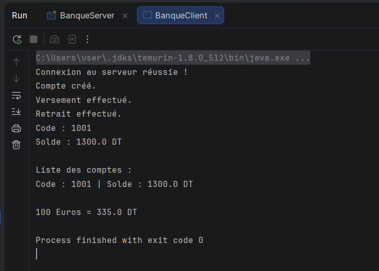

# TP6 – Application Bancaire Distribuée avec Java CORBA

## 1. Présentation du projet

Ce projet consiste à développer une application bancaire distribuée en utilisant Java et la technologie CORBA (Common Object Request Broker Architecture).

L'application permet à un client de communiquer à distance avec un serveur bancaire afin d'effectuer différentes opérations sur les comptes.

## 2. Objectifs du TP

Les fonctionnalités principales sont :

- Création d'un compte bancaire.
- Versement d'argent.
- Retrait d'argent.
- Consultation d'un compte.
- Affichage de tous les comptes.
- Conversion de l'Euro en Dinar Tunisien (DT).

## 3. Technologies utilisées

- Java JDK 8
- CORBA
- IDL (Interface Definition Language)
- IntelliJ IDEA
- Git et GitHub

## 4. Structure du projet

Le projet est composé de deux parties principales :

- `TP6_CorbaBanque_Server` : contient le serveur bancaire et l'implémentation des services.
- `TP6_CorbaBanque_Client` : contient le client qui appelle les méthodes distantes.

### Structure générale



## 5. Configuration de l'environnement

La configuration du projet utilise Java JDK 8 et IntelliJ IDEA.



## 6. Architecture et implémentation

### A. Partie Serveur

Le serveur contient :
- `Banque.idl` : définit l'interface distante.
- `BanqueImpl.java` : implémente les opérations bancaires.
- `BanqueServer.java` : démarre le serveur et enregistre le service sous le nom `Banque`.



### B. Partie Client

Le client utilise le Naming Service pour retrouver le serveur et invoquer ses méthodes à distance.

La classe principale est `BanqueClient.java`.



## 7. Exécution de l'application

Pour exécuter l'application, respecter l'ordre suivant :

**Étape 1 : Démarrer le Naming Service**

```bash
tnameserv -ORBInitialPort 900
```

**Étape 2 : Démarrer le serveur**

Exécuter `BanqueServer.java` dans IntelliJ IDEA.

Résultat attendu :

```text
Serveur Banque démarré !
Service enregistré sous le nom : Banque
```

**Étape 3 : Démarrer le client**

Exécuter `BanqueClient.java` dans IntelliJ IDEA.

Le client se connecte au serveur et réalise les opérations bancaires.

## 8. Résultats des tests

Les tests réalisés ont donné les résultats suivants :

| Fonctionnalité | Résultat |
|---|---|
| Connexion au serveur | Réussie |
| Création du compte | Réussie |
| Versement de 500 DT | Réussi |
| Retrait de 200 DT | Réussi |
| Consultation du compte | Réussie |
| Affichage des comptes | Réussi |
| Conversion EUR vers DT | Réussie |

### Exemple d'exécution

```text
Connexion au serveur réussie !
Compte créé.
Versement effectué.
Retrait effectué.
Code : 1001
Solde : 1300.0 DT

Liste des comptes :
Code : 1001 | Solde : 1300.0 DT

100 Euros = 335.0 DT
```

### Vérification du solde

Solde initial : 1000 DT

Versement : +500 DT

Retrait : -200 DT

**Solde final : 1300 DT**

### Conversion monétaire

Taux utilisé dans l'application :

1 EUR = 3.35 DT

100 EUR = 335 DT

## 9. Conclusion

Ce TP nous a permis de découvrir et de mettre en pratique les principes de la programmation distribuée avec Java et CORBA.

Nous avons appris à définir une interface distante avec IDL, à générer les classes Java correspondantes, à implémenter un serveur CORBA et à développer un client capable d'invoquer des méthodes distantes.

L'application réalisée démontre le fonctionnement d'une architecture client-serveur distribuée.

---

**Projet :** TP6 – Application Bancaire CORBA  
**Langage :** Java 8  
**Environnement :** IntelliJ IDEA  
**Année :** 2026